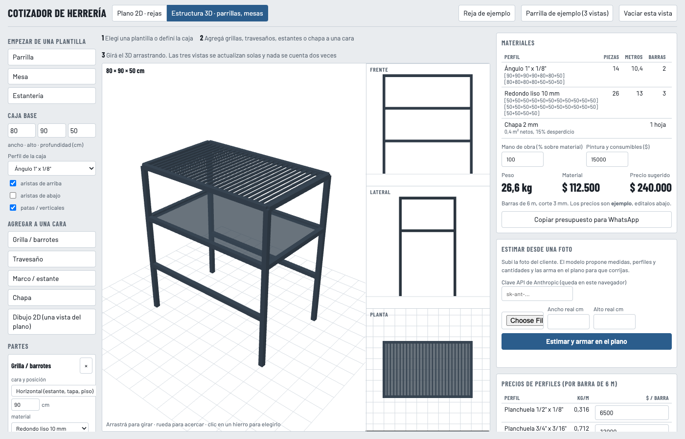
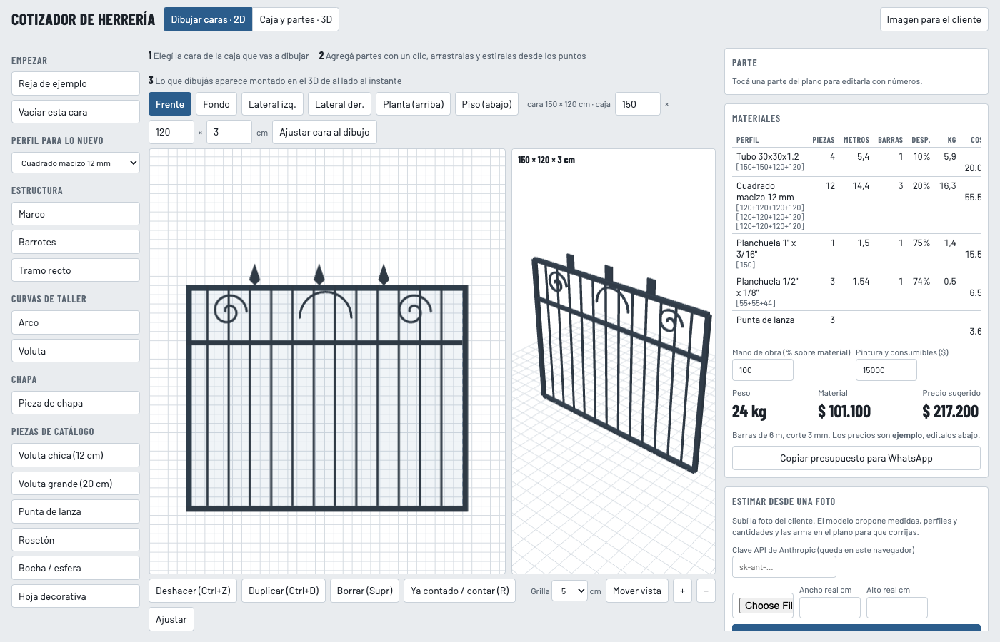
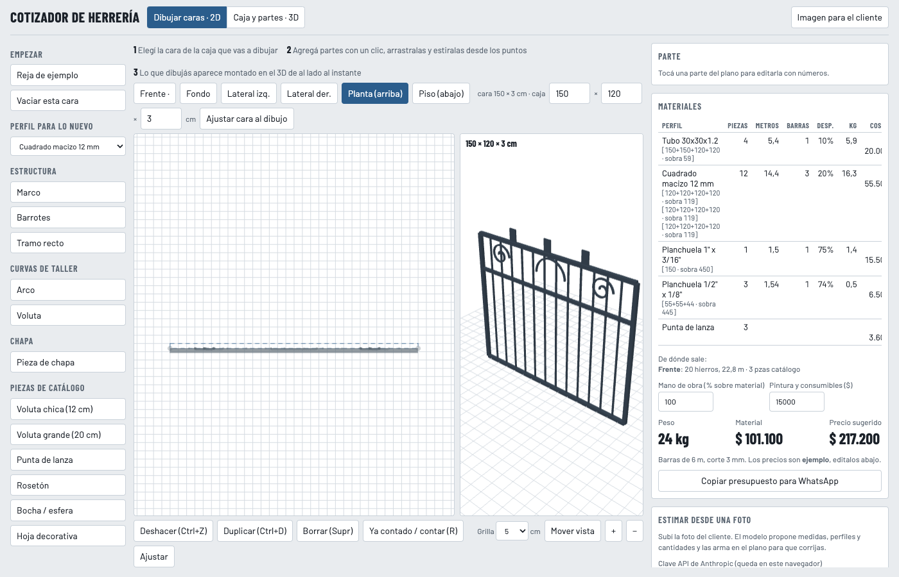

# Cotizador de Herrería

Diseñá una reja, una parrilla o una mesa como un modelo 3D de caja y caras, y obtené la lista de materiales sin contar un hierro dos veces: barras de 6 m con corte optimizado, chapa por m², peso y precio sugerido.

Un solo archivo HTML. Sin build, sin backend. Se abre en el navegador y guarda el trabajo localmente.



## Qué hace

- **Caja y partes · 3D.** Definís ancho, alto y profundidad, qué aristas existen (una mesa no tiene aristas abajo) y agregás partes interiores a una cara: grillas, travesaños, estantes, chapa. Las arrastrás en el 3D, las movés con las flechas, deshacés con Ctrl+Z. Las vistas Frente, Lateral y Planta se generan del mismo modelo.
- **Dibujar caras · 2D.** Las seis caras de la caja se dibujan con partes arrastrables: marcos, barrotes con paso, tramos, arcos y volutas con longitud desarrollada real, chapa y piezas de catálogo. Lo que dibujás aparece montado en el 3D al instante, y las otras caras muestran su proyección como fantasma para alinear.
- **Materiales.** Cada hierro existe una sola vez en el modelo. Si una arista de la caja y el borde de un marco dibujado ocupan el mismo lugar, se cuenta uno. Corte en barras de 6 m (first-fit decreasing, kerf 3 mm) con sobrantes, kg por tabla de perfiles, chapa en hojas de 1×2 m, catálogo por unidad, mano de obra y extras. Desglose por origen para auditar.
- **Modelos base.** Galería de doce modelos (rejas, portón, puerta, baranda, mesas, banqueta, rack, estantería, parrilla, brasero) con miniaturas renderizadas; elegís uno y lo retocás.
- **Proyectos.** Varios proyectos con nombre, guardados solos en el navegador, con duplicar, borrar y exportar/importar como archivo o texto para pasarlos a otro aparato.
- **Salida.** Presupuesto en texto para WhatsApp e imagen del 3D o del plano para el cliente.
- **Estimar desde una foto.** Con una clave API de Anthropic cargada en el navegador, el modelo propone medidas, perfiles y cantidades a partir de la foto que mandó el cliente y lo arma en el plano para corregir.





## Usar

En línea: **https://germanalvarez8.github.io/cotizador-herreria/**

O abrí `index.html` en el navegador. Es un archivo estático: cualquier hosting sirve.

Los precios de perfiles, chapa y catálogo son de ejemplo y se editan en la misma página. La lista de perfiles vive en el código, en el bloque `calc-begin`.

## Desarrollo

```bash
node check.js    # aserciones del bloque de cálculo (largos, corte, chapa, cantidades)
npm install      # Playwright, solo para validar en navegador
node shoot.js    # abre la página en Chromium headless, prueba interacciones y guarda capturas en shots/
```

Las librerías se cargan por CDN: Fabric.js 5.3.1 para el 2D y Three.js r128 para el 3D.

## Qué falta

Por orden de impacto en el número del presupuesto:

1. Precio por kg además de por barra.
2. Superficie para pintura y consumibles (discos, electrodo) calculados de la geometría.
3. Mano de obra por horas en vez de porcentaje, calibrada con un herrero.
4. Validaciones: partes fuera de la cara, hierros que atraviesan chapa.
5. IVA y margen separados.
6. Nesting de chapa en hojas reales.
7. Lista de precios actualizable desde la ferretería.
